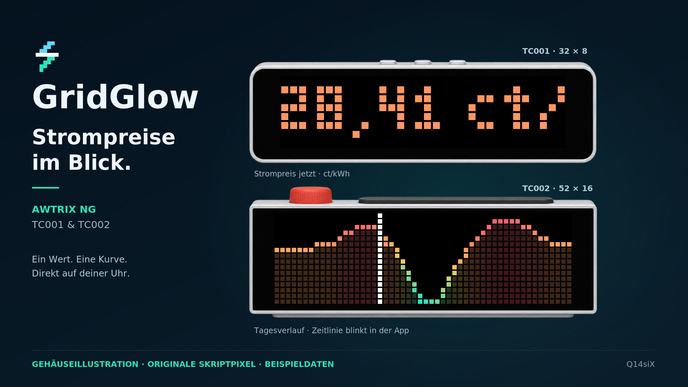

# GridGlow

**[GridGlow installieren / Open installer](https://q14six.github.io/GridGlow/)**

Version `20261113.152513` · [Deutsch](#deutsch) · [English](#english)

## Deutsch

GridGlow für AWTRIX NG auf Ulanzi TC001 und TC002 zeigt Tibber-Strompreise (ct/kWh), Preisdiagramme und verfügbare historische Verbrauchs-, Einspeise- und Kostenwerte. **Eine Anzeige pro installierter App**, gemeinsamer Tibber-Datenleser und gemeinsames Modul pro Uhr. Historische Werte sind keine Momentanleistung oder absoluten Zählerstände.

### Installation über GitHub Pages

1. Den **Inhalt dieses GitHub-Ordners** in das Stammverzeichnis des Repositorys auf `main` hochladen.
2. GitHub Pages: **Settings → Pages → Deploy from a branch → main / (root)**.
3. **[Installationsassistent öffnen](https://q14six.github.io/GridGlow/)**. Keine Installerdatei herunterladen.
4. Die Uhren aus dem vorbelegten FRITZ!Box-Netz `192.168.178.0/24` suchen oder IP-Adressen direkt eingeben; bei geschützten Uhren AWTRIX-Benutzername/Kennwort verwenden.
5. Anzeigen und Tibber-Einstellungen wählen und installieren. Bis zu zwei Uhren können parallel bearbeitet werden.

Die kleine `index.html` lädt die sechs Skriptdateien bei Bedarf aus `clocks/TC001/` bzw. `clocks/TC002/`. `release.json` nennt Release-Version und SHA-256-Prüfsummen. Bilder aus `images/` erscheinen bedarfsgesteuert. **Alle Dateien aus diesem Ordner müssen gemeinsam veröffentlicht werden.**

**Wichtige Browsergrenze:** Eine von HTTPS geladene GitHub-Pages-Seite darf im Browser nicht unter allen Umständen lokale HTTP-Uhren ansprechen. Mixed-Content- und Private-Network-Sicherheitsregeln hängen vom Browser ab und lassen sich nicht durch den Installer umgehen. Der Assistent meldet Verbindungsprobleme, aber eine direkte Installation ist nur mit erlaubtem lokalen Netzwerkzugriff möglich.

TC001: persönlicher Tibber-GraphQL-Token im Installer. TC002: OAuth-Client in der Weboberfläche der Uhr; Redirect URI `https://awtrix.de/oauth/callback`. Für historische Werte kann zusätzlich ein GraphQL-Token erforderlich sein. Bitte keine Tokens/Secrets im Repository speichern.

Vorschaubilder enthalten Beispieldaten. Bei fehlenden historischen Einspeisewerten kann die echte Uhr `--` zeigen. Ein Hardwaretest auf beiden Uhren ist noch erforderlich.

## English

GridGlow for AWTRIX NG TC001/TC002 displays Tibber energy prices per kWh, price charts and available historical import/export and cost figures. Each installed display has a single selected view; one data provider and shared rendering module serve all GridGlow displays on the same clock. Historical averages are not real-time power or absolute meter readings.

Publish **all files in this folder** to your repository root on `main`, configure GitHub Pages from `main / (root)`, and open **[the installer](https://q14six.github.io/GridGlow/)**. The installer fetches validated `.ax` scripts on demand from `clocks/`, with per-file SHA-256 hashes in `release.json`. Preview images and GIFs are loaded from `images/` as needed. No installer download is required.

The default network is `192.168.178.0/24`; authenticated clocks and up to two parallel clock installations are supported in the application logic. **Browser limitation:** GitHub Pages runs over HTTPS while many clocks expose local HTTP APIs. Mixed-content/private-network restrictions may block direct requests; the installer cannot bypass browser protections.

TC001 uses a personal GraphQL token. TC002 uses native OAuth configured on the clock, with redirect URI `https://awtrix.de/oauth/callback`. Never commit credentials to GitHub. Example previews are illustrative; physical hardware and actual account connections have not been verified.

License: MIT, see [LICENSE.md](LICENSE.md).
